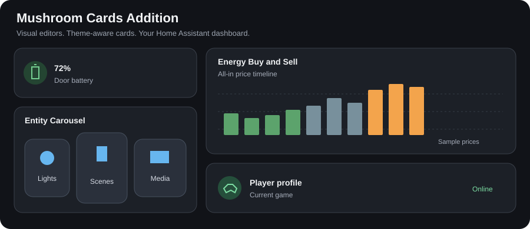

# Mushroom Cards Addition

[](https://github.com/snfx-johaver/mushroom-cards-addition/actions/workflows/ci.yml)

**Build a more useful Home Assistant dashboard without writing YAML.**
Mushroom Cards Addition is a HACS-installable collection of **25
dashboard components**, with graphical configuration, theme-aware styling and
Home Assistant actions. It is a frontend custom-card collection, not a backend
integration, and works alongside Mushroom without depending on its internals.

Explore live energy flows, buy/sell price timelines and profit estimates, solar
panel health, recorder-backed Mini Graph charts, combined Sun/Moon views, media
controls, room overviews, battery intelligence, plant and pollen monitoring,
NAS metrics, speed tests and more. Configure entities, presentation and supported
controls directly in the dashboard editor; YAML remains available when preferred.

The catalog maps **21 documented sources**—4 default-card sources and 17 custom-card
sources—to **25 public components**, including five original additions. Related layouts are grouped into graphical
variants instead of duplicating picker entries. See the
[complete, source-linked catalog](docs/CATALOG.md), the generated
[item-by-item parity matrix](docs/PARITY_MATRIX.md), and the
[visual behavior specification](docs/VISUAL_SPEC.md).



## Requirements and compatibility

- Home Assistant 2024.4 or newer
- A modern browser supported by Home Assistant
- [Mushroom](https://github.com/piitaya/lovelace-mushroom) is recommended for a
  cohesive dashboard, but this plugin does not depend on Mushroom internals.

The plugin uses Home Assistant's public custom-card surface and native
`ha-form`, icon, entity, color, and action selectors. Compatibility guards
provide preview rendering before `hass` is available and explicit unavailable
states for missing entities.

### Area card advanced

**Mushroom Addition - Area card advanced** (`custom:mushroom-addition-area-card-advanced`)
hosts the **installed native Home Assistant Area card and its native editor**.
It does not copy or reimplement Area: camera/picture/icon/compact modes, alerts,
sensors, exclusions, layout, actions, standard controls and future native options
are forwarded. This card specifically requires a frontend supporting native Area
custom features (the target instance is Home Assistant 2026.10.2); the general
2024.4 minimum above is not a compatibility promise for this card. Missing native
helpers/components produce visible errors with retry, not a simulated fallback.

In **Advanced area controls**, compact chips-style rows have drag handles,
native Home Assistant sortable grips and edit/remove icon buttons, matching Features
(keyboard: Alt + Up/Down). **Add button** offers
Entity (any domain), Action, Conditional and Template. Edit a row to configure
name, inferred/custom icon, icon color, entity picture, content (name, state,
relative last-changed/last-updated, attribute or custom text), and native
tap/hold/double-tap action selectors. Names/content sit **below the icon,
bottom-aligned**, using a shared 64px row; unnamed controls retain the native
42px baseline. Named rows reserve one extra grid row. Conditional buttons use
the installed native conditional card and conditions editor, including nested
conditions/buttons. Template content/name/icon/color use HA `render_template`
websocket subscriptions, surface backend errors and unsubscribe on removal.
Conditional controls disable native preview mode and remain mounted while
native-hidden, with no reserved horizontal slot, so native condition listeners
can restore visibility. On frontends that evaluate conditions on the server,
changing a cloned frontend `hass.states` object is not a valid visibility test:
the real server verdict remains authoritative.
Templates can reference `config`, `entity` and `user`, plus normal HA template
globals. These are button counterparts to the four chip types, not a dependency
on Mushroom chips or a claim to support every specialized chip type.

**Text below the icon** explains each content choice. Selecting **One of the
entity's attributes** reveals a dropdown of that entity's properties, such as
brightness; selecting **Your own text** reveals the text box. Unused fields stay
hidden. Add or remove controls features through the native **Features** section;
there is no duplicate feature-add button in the advanced controls list.

The native **Content** section also provides **Alert icon color** (clear it to
restore HA's default alert circles/badge), **Wrap sensor values onto additional
lines**, and **Show small grey entity icons beside sensor values**. Sensor values
still come from native Area aggregation, ordering, exclusions and locale formatting.
These opt-in enhancements use the native secondary slot and scoped styles. They
depend on installed frontend internals; recheck them after Home Assistant updates.
Content also offers **Use the light color as the room accent** (`use_light_color`).
No light selector is needed: it automatically uses an active RGB light in the
card's selected area, respecting native area membership and excluded entities.
Lights inherit their device's area when they have no entity-level area. The
first usable light in stable entity-ID order supplies the subtle tint, including
light-group members. Old `light_entity` values are ignored. Turning the option
off, changing area or losing all usable active lights clears the tint; explicit alert
and control colors remain independent. Off/unavailable buttons retain a neutral
theme-aware background in light and dark themes.

Standard domain groups remain native (including group membership, exclusions,
state and toggle semantics). For item-specific icons/actions, add an entity
button instead of overriding an aggregate domain group. Domain color overrides
are supported graphically; YAML domain icon/action overrides display an explicit warning.
Omitting `controls` retains automatic HA controls **once**; `controls: []` renders
none. Adding buttons to an automatic feature explicitly switches it to a manual
list; use a separate controls feature if automatic groups must remain alongside.
Action/template/conditional buttons are edited only in the advanced list and are
omitted from the native editor's controls projection. Saved features retain
`type: area-controls`; the custom feature type is runtime-only.

```yaml
type: custom:mushroom-addition-area-card-advanced
area: office_joris
display_type: icon
alert_color: red
sensor_wrap: true
sensor_icons: true
features_position: bottom
features:
  - type: area-controls
    controls:
      - light
      - type: entity
        entity_id: sensor.office_temperature
        name: Temperature
        content_info: name
        icon: mdi:thermometer
        icon_color: orange
        tap_action:
          action: more-info
      - type: action
        name: Work
        icon: mdi:desk
        tap_action:
          action: perform-action
          perform_action: scene.turn_on
          target:
            entity_id: scene.office_work
      - type: conditional
        conditions:
          - condition: state
            entity: light.office
            state: "on"
        control:
          type: template
          entity_id: light.office
          content: "{{ state_attr(entity, 'friendly_name') }}"
          icon: mdi:lightbulb
          tap_action:
            action: toggle
```

Automated tests prove delegation and extension contracts with fake native
elements; they do **not** establish complete live Area visual/behavior parity.
Live checks on HA 2026.10.2 cover native display-mode sizing, editor round trips,
bottom-aligned labels at 320px and 440px widths, conditional visibility and
server-rendered templates. Recheck native frontend internals and named-row
geometry when Home Assistant changes. Structurally identical native controls/features
round-tripped without object identities use occurrence matching; use the advanced
list to reorder duplicate buttons with distinct overrides unambiguously.

### Media Player Advanced

The separate basic Media Player card has been removed. Existing Sonos card YAML
continues to work with its existing `custom:mushroom-addition-custom-card-media-player-sonos`
type; its picker and editor now use the Media Player Advanced name.

Media Player Advanced (previously named Media Player Sonos) supports `use_media_info`,
`volume_controls`, `media_controls`, and
`collapsible_controls` options in its visual editor. Volume and media controls
use native multi-select checkbox lists. Only controls supported by the entity's
`supported_features` are shown. Unknown/unavailable players cannot be controlled.
**Use media info** replaces the normal name/state header with the media title and
artist, including when the visual editor has populated Name/State information
modes. Turning it off restores the entity name/state; custom names/text,
hidden fields and explicit alternate state/name/time modes remain respected.
The independent **Show artist and album details** switch can retain metadata
below the entity name even with Use media info off.
Missing metadata falls back to the entity/source rather than empty text.
**Volume slider and percentage** under **Volume controls** is the single volume
level option. The percentage sits beside the slider, not duplicated in the
header. The redundant `show_volume_level` editor toggle was removed and that
legacy setting no longer changes the header.

**Show power button** is a separate switch (never duplicated in Media controls).
Players supporting hardware power use **Turn on/off**. Always-on players such as
Sonos and Music Assistant without those capabilities use **Standby (stop playback)**
and **Resume playback**, through supported `media_stop`/`media_play` services;
this does not physically switch off the speaker. Unsupported actions are hidden.
Legacy `media_controls: [on_off]`
still works unless the explicit power switch is off. **Sources and details**
in Media controls opens HA's existing entity dialog.
**Playback control entity** optionally targets another media player for power,
playback, mute, shuffle, repeat and volume; its state/capabilities determine the
controls while artwork/title and Sonos sound settings retain the main entity.
A missing/unavailable target is disabled, never replaced by the main player.
**Volume button step** accepts 0.01–1 (`0.05` = 5%) and clamps volume to 0–100%;
leave it empty for native volume steps. A player without volume-set support
retains its native steps. **Treat idle as inactive** adds idle to the collapsed
states when **Collapse controls when off** is enabled; standby also collapses.
The primary icon follows the entity's icon unless you explicitly override it.

```yaml
type: custom:mushroom-addition-custom-card-media-player-sonos
entity: media_player.living_room
use_media_info: true
ulm_card_media_player_power_button: true
volume_controls: [volume_mute, volume_set, volume_buttons]
media_controls: [shuffle, previous, play_pause_stop, next, repeat, sources]
collapsible_controls: true
```

Media info displays the title and artist while respecting shared primary and
secondary information overrides. Collapse hides controls when off, unknown, or
unavailable, retaining a selected, supported power button. Artwork, Sonos detail
switches/sliders, and playlist shortcuts remain available while expanded.
New cards include the full control selection; existing YAML without control
arrays retains volume down / play-pause / volume up. Set either array to `[]`
to hide that group. Volume sliders commit once when changed, and repeat cycles
through off → all → one → off.

## Install

Until the repository is accepted into HACS:

1. In HACS, open **Custom repositories**, and add
   `https://github.com/snfx-johaver/mushroom-cards-addition` as a Dashboard
   repository.
2. Install **Mushroom Cards Addition** and restart Home Assistant if HACS asks.
3. If HACS does not add the resource automatically, add
   `/hacsfiles/mushroom-cards-addition/mushroom-cards-addition.js` as a
   JavaScript module under **Settings → Dashboards → Resources**.
4. Add a card from the Lovelace card picker and search for
   **Mushroom Addition**.

[Open this repository in HACS](https://my.home-assistant.io/redirect/hacs_repository/?owner=snfx-johaver&repository=mushroom-cards-addition&category=plugin)

This is a HACS **Dashboard** repository (category `plugin`), not a backend
integration. Default-store inclusion requires a reviewed submission to
[`hacs/default`](https://github.com/hacs/default); until accepted, install using
the custom-repository steps above. The HACS validation job runs without ignored
checks on every push and pull request.

When a build is refreshed without changing its version, existing HACS users
must use **Redownload** for v0.0.1 and reload their browser; a same-version update
does not trigger a new-version notification.

For a manual installation, copy `dist/mushroom-cards-addition.js` into
`config/www/community/mushroom-cards-addition/` and register
`/local/community/mushroom-cards-addition/mushroom-cards-addition.js` as a
module. After replacing a manually installed bundle, use
`/local/community/mushroom-cards-addition/mushroom-cards-addition.js?v=0.0.1`
(or increment the query token) and hard-refresh the Home Assistant frontend to
invalidate the browser cache.

## Versions and releases

Published releases use Semantic Versioning tags (`vMAJOR.MINOR.PATCH`), starting
with **v0.0.1**. While the project is below 1.0, minor releases may introduce
breaking configuration changes; patch releases contain compatible fixes.
See [release notes](https://github.com/snfx-johaver/mushroom-cards-addition/releases)
and the [changelog](CHANGELOG.md) before upgrading.

`package.json` is the source of truth for the version displayed by the frontend.
The lockfile and release tag must match it; `npm run check:version` checks the
manifests, and `npm run check:version -- v0.0.1` also checks a tag.

To prepare a release from a clean checkout, update the changelog, then run
`npm version <version> --no-git-tag-version` (for example,
`npm version 0.0.2 --no-git-tag-version`). This validates the current version,
updates both manifests and rebuilds the bundle without creating a commit or tag.
Run `npm run validate`, commit the manifests, changelog and built `dist` files,
then push the release commit and an annotated `v<version>` tag. The release
workflow validates the tag and code before publishing the JavaScript bundle
and source map as GitHub release assets for HACS and manual installation.

## UI usage

Each distinct public component appears once in the card picker. The shared graphical
editor supports entity and multi-entity selection, name, secondary text, icon,
color, layout, documented variants, state visibility, and Home Assistant
tap/hold/double-tap actions. Hidden compatibility aliases keep existing YAML working while new
dashboards use the unified component and a friendly style dropdown. Card-picker
previews automatically select compatible entities from
the current Home Assistant instance so examples show real names and states.

NAS, Speedtest, Pollen, Roomview, and the
Advanced Energy cards use aligned Mushroom headers with a 40px icon beside
the primary and secondary information. Their header icon and information
selectors are editable independently of the metric, forecast, and status icons
inside each card. Choose **Icon type: None** to hide only the header icon.
All standalone cards use Home Assistant's theme-controlled card border width
and color, like official Mushroom cards.
Header icons follow the selected entity by default, including Home Assistant's
device-class/state icon when `attributes.icon` is absent. Picker/editor defaults
no longer save a recommended card icon as an override. Clear a previously saved
Icon override to follow the entity; explicit custom icons and entity pictures are
preserved. A card-specific fallback is used only when no entity is available.
Battery retains its computed level/charging glyph when the entity has no explicit
icon, together with its threshold colors. Semantic chart/metric/action glyphs
remain independent of the header icon.
NAS status and metric content also uses Mushroom's 14px primary/12px secondary
text defaults and 40px icon containers with 24px symbols at every width. Theme
overrides for Mushroom font/icon sizes apply; the rings retain their chart sizing.

### Roomview

Roomview keeps its compact appearance. **Climate**, **Sensor status**
and **Device controls** are sections in the graphical editor only, which puts primary entity presentation
first, then gives each section its own controls. Existing `temperature`, `humidity`
and `group_*` entity bindings are unchanged.

The climate header independently supports `climate_name` (including composed
entity names), `climate_icon`, `climate_icon_type` (`icon`, `entity-picture`, `none`),
`climate_primary_info` and `climate_secondary_info` (`name`, `state`, `none`),
and `climate_secondary` custom text. By default it shows temperature and humidity.
A configured climate name replaces the primary temperature text unless
`climate_primary_info` selects otherwise. Leave `climate_secondary_info` unset
for custom text or humidity; `state` selects the temperature entity's state.
Climate icons use the override, temperature entity icon, then the original room icon,
independently of the primary entity icon. Entity pictures come from temperature.

Sensor indicators retain compact icons with accessible labels; missing/unknown/unavailable
entities and missing group members are reported rather than showing an all-clear.
Group active counts, low battery counts, and unavailable counts remain visible.
Indicators open entity information; they are visually distinct from device buttons.

Each device has independent graphical Home Assistant actions:
`lights_tap_action`, `lights_hold_action`, `lights_double_tap_action`, and the
same three suffixes for `shutters`, `outlets`, and `tv`. They target the existing
`group_lights`, `group_windows_shutters`, `group_outlets`, and `group_tv` entities,
respectively. Tap defaults to safe **more-info**, hold (500 ms) defaults to
**more-info**, and double tap retains the legacy **toggle**. Set any action to
`{ action: none }` to disable it. Action-specific `entity` overrides are honored,
along with normal Home Assistant action targets and payloads.
Enter/Space runs the tap action. A pointer tap waits briefly for a possible double
tap; double taps and holds never also trigger tap or whole-card actions.

**Advanced Energy - Energy Buy and Sell** includes a collapsed **Buy and sell
result** dropdown beneath its timeline. Expand it to see the selected buy/sell
slots, energy-weighted average prices, kWh, costs/revenue and net result. The
graphical editor controls visibility, minimum trade size (or an optional kWh
entity), charging/selling power, round-trip efficiency, feed-in fee and slot
duration. Defaults are 10 kWh sold, 7.2 kW, 86%, no additional feed-in fee and
15-minute slots. Prices must already be all-in euros per kWh; do not add a fee
again if it is already included.

The estimate uses all published price slots, independently of the chart's
visible range and planned-action colors. It buys in the cheapest slots and sells
in the most expensive remaining slots without reusing a slot. The final slot
can be partially used. Slot times may be non-contiguous and sales may precede
purchases: this is an estimate, not a battery-capacity-aware operating schedule.
Missing prices, an unavailable trade-size entity or insufficient separate slots
produce an explicit message rather than a fabricated profit.

The **Room Card** (`custom:mushroom-addition-card-room`, not Roomview) has a
**Status indicators** section under **Features** in its visual editor. Add up to
four small entity icons of kind `window`, `door`, `motion` (including occupancy),
`water` (moisture) or `smoke` (fire). These are separate from the existing
`room_sensors` action buttons. Triggered water/smoke icons pulse blue/red; reduced
motion keeps a static alert color. Inactive icons stay neutral, unavailable or
unknown entities are dimmed and disabled, and each indicator exposes its name
and state accessibly. Available indicators open entity details when tapped.
The small indicators flow directly below the secondary information and above
the large room icon, within the left column. The square card and icon sizes are unchanged.

Enable **Use the light color as the room accent** (`ulm_card_dynamic_color`)
and choose **Room light (brightness and accent)** (`room_light_entity`), or use the main light
entity. The accent uses an on light's RGB, including an active RGB group member
when the group has no RGB. Off, unavailable, missing or invalid RGB retains the
normal theme. No light service calls are made by the accent.
Disabling the accent keeps the **Room** background neutral,
even with the light on; individual light controls retain their on/off colors.

Room's **Show temperature label** and **Show brightness label** switches can be
used together. Optional `room_temperature_entity` (sensor/climate) defaults to the
primary entity. The single `room_light_entity` selector supplies both brightness
and the optional accent, defaulting to the primary light. Older brightness-only
configs migrate `room_brightness_entity` into this field; when both were set,
`room_light_entity` takes precedence. Numeric temperature states/attributes require a
temperature unit (`°C`, `°F` or `K`); climate/temperature attributes and temperature
class sensors may use Home Assistant's configured temperature unit. Brightness
requires a valid 0–255 attribute and is displayed as a percentage. Missing,
unknown, unavailable and nonnumeric values never produce fabricated labels.
Status indicators share the square buttons' neutral background while retaining
their compact circular geometry and alert colors.

Welcome navigation buttons reserve space for their lower curves and shadows
inside the row. Narrow rows scroll horizontally instead of cutting buttons off.
Scenes and Welcome Scenes use the same borderless shadow treatment as Welcome,
retaining each button's original shape. Welcome Scenes' weather/date display has
no background.

The Trash card's **Hide items without a known date** option
(`hide_unknown_dates: true`) automatically hides missing/empty/unavailable
collection dates and calendar rows without a valid event date. Rows reappear
when a date arrives. It is off by default; unknown dates otherwise show a dash.

Room-only secondary information precedence:

- `none` hides all secondary information.
- `custom` displays only `secondary` text, even when empty.
- `composed` displays only the ordered `room_secondary_parts` list, even when empty.
- `name`, `last-changed` and `last-updated` retain their explicit meanings.
- Unset/`default` uses nonempty legacy `secondary` text first, then enabled valid
  feature labels joined by ` · `, falling back to the primary state.
- `state` preserves the primary state and appends enabled valid feature labels
  (including when old configurations explicitly set `secondary_info: state`).

Choose **Composed (primary entity values)** under **Content** to add, remove or
move information parts up/down. Each part reads the current primary entity:
`text` (`text` value), `name` (entity friendly name), `state`, `brightness`,
`temperature`, or `attribute` (`attribute` key selected from the primary entity).
Parts are joined with ` · `; missing values are omitted. Composition does not
use the feature-label entity selectors or switches.

```yaml
secondary_info: composed
room_secondary_parts:
  - type: text
    text: Living room
  - type: state
  - type: brightness
  - type: attribute
    attribute: color_mode
```

Room selection helper options and their implicit double-tap action are removed
for Room; old `input_select_entity`, `input_select_option`, `ulm_input_select`
and `ulm_input_select_option` values are ignored. Explicit standard card actions
still work. Room action buttons populate entity-specific icons, picture mode,
active state, blue color and tap/hold/double-tap defaults on entity selection.
Inferred values refresh on entity changes while explicit overrides are retained.
Sensors open details by default; other entities toggle. Legacy button names are
kept as accessible labels, not editable/visible names. Scene names are unchanged.
Use **Move up**/**Move down** on Room sensor button rows to persist their order
without changing their icons or actions. Boundary buttons are disabled.

```yaml
type: custom:mushroom-addition-card-room
entity: sensor.room_temperature
room_light_entity: light.living_room
ulm_card_dynamic_color: true
room_status:
  - entity: binary_sensor.window
    kind: window
  - entity: binary_sensor.leak
    kind: water
  - entity: binary_sensor.smoke
    kind: smoke
room_sensors:
  - entity: light.living_room
```

The **Game Console Card** supports automatic, Xbox, PlayStation and Nintendo
platform selection. Its single header uses the profile image, profile name and
current game; the graphical information selectors can override the text.
Social counts, statistics, artwork and power controls remain independently configurable.

The **Waste Collection Card** has an ordered graphical list of waste streams.
Each row can be enabled independently and has its own sensor/calendar entity,
label, icon, and color. Empty or disabled rows are omitted from the rendered card;
legacy `ulm_card_datum_*` variables are migrated automatically.

```yaml
type: custom:mushroom-addition-custom-card-trash
entity: sensor.next_collection
name: Waste collection
tap_action:
  action: more-info
hold_action:
  action: more-info
```

The **Mini Graph Card** is a fully graphical, recorder-backed implementation of
the complete public `kalkih/mini-graph-card` configuration surface. It supports
line and bar graphs, multiple series, per-entity overrides, aggregation,
primary/secondary axes, thresholds, state maps, attributes, fixed values,
statistics, caching, logarithmic scales, smoothing, animation, and Home
Assistant actions without requiring another frontend resource. See the
[configuration and example guide](docs/MINI_GRAPH_CARD.md).

The **Entity Carousel Card** includes dependency-free Slide, Coverflow, Fade,
Cube and Flip effects with graphical controls for cursor behavior, centering, automatic or
fixed slides per view, rotation, spacing, depth, intensity, and slide shadows.
Fade, Cube and Flip automatically use one centered item; the geometry controls
only apply to Coverflow. Keyboard focus retains a visible outline, but the
selected tile no longer has a different border or inset ring.
In **Layout**, enable **Show previous/next buttons**, **Show pagination**
(clickable dots, item count or progress bar), or **Show draggable position
scrollbar**. Navigation disables at non-looping endpoints. Pagination and the
scrollbar select without activating scenes; tap the centered tile to run its
action. Arrow/Home/End keys, horizontal swipe, wheel, hold and double-tap remain
available, and reduced-motion preferences disable animated transitions.

Catalogue examples now choose up to seven healthy lighting scenes from one
room, using Hue room metadata or known light membership and area/device
registries. The header uses a light in that room when available. Mixed-room,
non-light and unavailable scenes are excluded; if no room relationship can be
established, the item list starts empty rather than using unrelated sensors.
Example scene buttons explicitly activate their scene when tapped.
Turn off **Show card header** in its graphical editor to hide the title, icon
and primary/secondary information while keeping the carousel and its item labels.
Turn off **Show selected item label** as well for a compact, icon-only strip.
Use **Use entity icon** to clear a header or item override; Home Assistant then
chooses the entity's icon, including device-class and state-specific icons.
Each item's tap, hold and double-tap selectors support **Default** (tap opens
more info; hold and double-tap do nothing). An explicit double-tap action
waits briefly before firing a single tap so the two actions never run together.
Existing Swipe Card-style YAML can also use the source-compatible `parameters`
shape:

```yaml
type: custom:mushroom-addition-custom-card-entity-carousel
parameters:
  effect: coverflow
  navigation: true
  pagination:
    type: bullets
  scrollbar: true
  grabCursor: true
  centeredSlides: true
  slidesPerView: auto
  coverflowEffect:
    rotate: 0
    stretch: 0
    depth: 400
    modifier: 1
    slideShadows: true
```

## Design and behavior

Registrations share typed configuration, entity/state formatting, action
handling, responsive layout, keyboard interaction, focus treatment, ARIA
labels, unavailable and preview states, and Home Assistant theme variables.
They do **not** share one generic visual tile: weather, climate, lights, scenes,
people, batteries, energy/graphs, media, covers, vacuums, security, and navigation
use dedicated renderers and family-specific visual editors.
Related upstream YAML variants are exposed through relevant UI controls.
Previous separate custom-element tags remain hidden compatibility aliases so
existing dashboards continue to render without cluttering the picker.


No upstream YAML, JavaScript bundles, or assets are copied. This is an original
Lit implementation based on documented public behavior. See the per-item source
links in the [catalog](docs/CATALOG.md).
The renderer decisions and upstream source references are documented in the
[visual specification](docs/VISUAL_SPEC.md).

## Troubleshooting

- **Card not in picker:** hard-refresh the browser and verify the resource is a
  JavaScript module.
- **Entity unavailable:** select an entity that exists and is visible to the
  current Home Assistant user.
- **Editor selector missing:** update Home Assistant to a supported release;
  selector elements are supplied by the Home Assistant frontend.
- **Stale release:** clear the frontend cache or append a temporary query string
  to the resource URL after updating.

## Development

Requires Node.js 20 or newer.

```sh
npm install
npm run validate
```

`npm run validate` runs ESLint, strict TypeScript checking, catalog consistency
checks, component tests, and the production Vite build. The distributable is
`dist/mushroom-cards-addition.js`.

## Contributing

Please include tests for shared behavior or the affected component family and
update `src/catalog.ts` when upstream coverage changes. Run
`npm run docs:catalog` after catalog edits and `npm run validate` before opening
a pull request.

## License

Mushroom Cards Addition is MIT licensed. Mushroom and Home Assistant
are independent projects and trademarks of their respective owners.
Required third-party copyright and license notices are retained in
[THIRD_PARTY_NOTICES.md](THIRD_PARTY_NOTICES.md).
