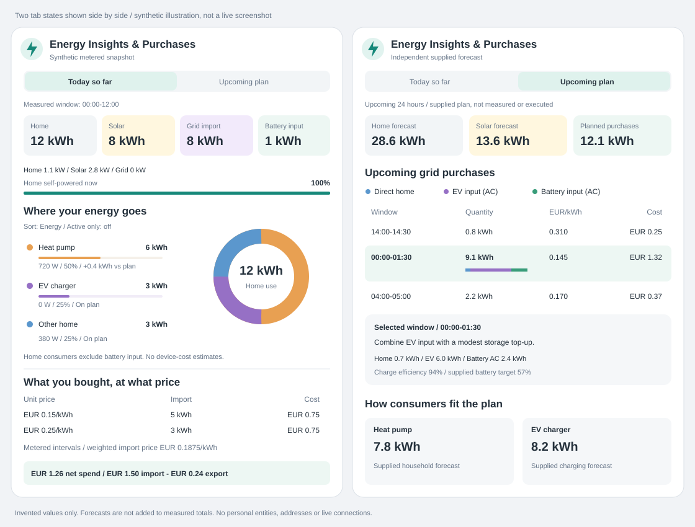

# Energy Insights & Purchases

Choose **Mushroom Addition: Energy Insights & Purchases** in the Home Assistant
card picker. The card is in the existing bundle; no separate resource or data
service is installed. Defaults contain no entities or invented readings.

The card preserves the concept's two distinct reporting surfaces: measured
actuals (for example 00:00–12:00) and an independent supplied upcoming 24-hour
purchase plan. It is a viewer and accounting surface, not an optimizer, device
controller or recorder integration. Actuals can use either a legacy measured
snapshot or user-selected cumulative meters and timestamped price sensors.

The illustration shows measured and upcoming-plan tabs side by side for
comparison only. All figures are invented, not production fallbacks.

## Native configuration

The minimal shared editor adapter retains Context, Content, Layout, Interactions
and Features. There is no separate Energy Insights editor element. Under
**Features → Energy Insights & Purchases → Edit**, standard Home Assistant forms
and structured object selectors configure all settings. Native add/edit/delete
dialogs and drag ordering manage consumers; every object has explicit fields,
so no setting requires YAML or an unstructured object editor.

Native structured selector behavior is verified against released **Home Assistant
2026.11 / frontend 20261028.4**, the supported baseline for these editors.
See the [released selector implementation](https://github.com/home-assistant/frontend/blob/20261028.4/src/components/ha-selector/ha-selector-object.ts).
The local demo uses clearly identified shims, not an actual Home Assistant host.

Shared configuration includes the heading entity, name, icon, primary/secondary
information, supporting text, heading layout, multiline secondary text, card
shadow, fill-container behavior, and header tap/hold/double-tap actions.
The heading entity is independent of the two snapshot sources below.
Tabs support arrows/Home/End and native keyboard focus. Purchase rows select a
live-announced rationale. Tables have scroll containers on narrow dashboards;
colors and surfaces inherit the Home Assistant theme.

## Feature settings

All settings below live under `energy_insights`:

| Setting | Meaning |
| --- | --- |
| `actualSource`, `planSource` | Optional legacy measured snapshot and supplied plan; each has a sensor `entity`, attribute-object `path`, and structured `fields` mappings |
| `metered` | Solar, grid import/export, battery charge/discharge and import-rate sensor selectors, with optional attribute-field mappings; export rate is optional |
| `currency` | Optional ISO currency code; otherwise use Home Assistant's currency |
| `fixedExportRate` | Optional fixed feed-in rate in the configured currency/kWh; mutually exclusive with an export-rate sensor |
| `maxAgeMinutes` | Maximum snapshot/live/history-refresh age, 1–10080 minutes; default 60 |
| `activeThreshold` | Active consumer threshold in W; default 50, strictly greater than |
| `sort` | `energy` (default) or `power` |
| `activeOnly` | Initial active-only filter; default false |
| `showHeader`, `showFlow`, `showConsumers`, `showPurchases`, `showForecasts` | Independent visibility controls, default true |
| `showPlanBattery`, `showPlanAllocations`, `showPlanEfficiency` | Show and validate corresponding supplied-plan details; defaults true for compatibility |
| `homeEntity`, `solarEntity`, `gridEntity`, `batteryEntity` | Optional live power sensors with W or kW units |
| `selfPoweredEntity` | Optional fresh percentage sensor for the home self-powered indicator |
| `consumers` | Up to 32 ordered consumer definitions |

Positive grid power means import; negative means export. Positive battery power
means charging; negative means discharge. Adapt source sensors to this convention.
Live power requires a fresh `last_updated`; unknown, unavailable, stale or
wrong-unit values are explicitly unavailable. No history is inferred from power.
The self-powered indicator is source-backed too: net grid power alone cannot
identify which imported energy feeds the home versus battery charging, so this
percentage is never guessed from those power readings.

When `actualSource.entity` is not set, **Metered intervals** supplies today's
measured data. Select cumulative energy sensors for solar production, grid
import/export and battery charge/discharge, plus a timestamped import-rate
sensor. Each energy sensor must expose a cumulative `Wh`, `kWh` or `MWh` value
and unit in its Recorder history; each price sensor must expose its rate as
currency/kWh or cents/kWh. A `Field` mapping reads a numeric attribute instead
of the entity state. Explicit **Not installed** flags are available for solar,
grid export, battery charge and battery discharge. They mean the user has
confirmed those flows do not exist; an unconfigured sensor never silently means
zero. Grid import cannot be declared absent.

The optional export-rate sensor or **Fixed export rate** calculates feed-in credit.
Without either, export credit is marked **Not supplied** and is not subtracted
from the displayed import cost.

The accounting window begins at local midnight in Home Assistant's configured
time zone (including DST) and ends at the HA state snapshot captured when the
history request starts, **not** when the request finishes. Recorder readings and
the captured current cumulative values establish a common endpoint for independent
meters and consumers. A numeric, available current state is HA's current cumulative
reading even if its `last_updated` is old because it has not changed; an idle
export or battery meter is not rejected just for that timestamp. No power is
extrapolated after the last update. Where the last state update precedes the
common endpoint, a visible approximation notice states that the current counter
is carried forward assuming no change between reports, not a synchronized
physical sample. Diagnostics retain both the accounting endpoint and last state
update timestamp. A newer current reading bridges Recorder lag; newer Recorder
readings take precedence when the frontend state subscription lags. The current
state is compared with the Recorder observation at its own timestamp, not with
a later reading. Recorder's microsecond timestamps and HA's truncated millisecond
ISO timestamps are synchronized at millisecond precision. A conflicting value
for the same observation, future timestamp, invalid state, or observed
decrease fails that source. The card separately shows the last successful refresh and each
source's accounting window in collapsed diagnostics. Home consumption is derived from the
configured energy balance, not read from a HEMS snapshot:

`solar + grid import + battery discharge - battery charge - grid export`

Meter inputs must use comparable AC boundaries. Counters must be cumulative
and non-resetting. History must contain a cumulative baseline at or before midnight.
The card uses the **last recorded HA state at midnight** as its baseline. If the
last change preceded midnight, the first subsequent delta is attributed to today
with a visible approximation notice: its physical timing is uncertain.
It does **not** interpolate energy across the last-change timestamp, which can be
many hours old on an idle meter. Recorder also synthesizes a carry-in row at the
requested history start; complete history with no intervening changes establishes
the same held HA state at midnight. This convention is independent of request
lookback length and supports idle export meters whose first change is at midday.
It is **HA state-change accounting, not an exact physical midnight measurement**.
An unchanged carry-in/current counter establishes zero reported energy.
A missing, unknown or unavailable carry-in is not replaced by zero.

Daily/reset production meters are **not supported as non-resetting counters**, even
when HA labels them `total_increasing`. Choose a lifetime production counter, or
provide a validated snapshot instead. An observed reset fails solar and the derived
household total; an unavailable midnight baseline does likewise. Neither a daily
sensor's current value nor its first morning reading proves zero at midnight.

Recorder tariff history must cover each nonzero energy interval. A tariff change
inside a meter interval splits its energy in proportion to elapsed time. The
individual rate allocations and resulting costs are approximate, while the
interval's original cumulative delta is conserved. Changes exactly on meter
boundaries and redundant equal-rate observations require no estimated allocation.
Negative and zero rates are supported. The optional feed-in rate sensor follows
the same rules.
Fixed rates are explicitly assumed constant over the measured day.
An always-visible **Approximate accounting** notice explains affected sources and
assumptions; affected interval rows carry `≈`. Midnight timing uncertainty propagates to
energy totals, household shares and affected costs. Aligned cumulative endpoints
and constant tariffs require no allocation estimate, but carry-forward endpoint
assumptions are still labeled independently.
Accounting notices, their assumption explanations, last-state-update labels and
table-limit notices are translated in all 33 supported languages. Changing the UI
language also updates cached accounting explanations without another history
request; technical source IDs and measured values are preserved.

Energy and pricing validate separately. A missing or invalid tariff leaves valid
import/export kWh visible, marks affected prices/costs **Not supplied**, and
explains the problem. It never shows a partially priced day as a complete cost.
Likewise, a missing energy meter does not hide unrelated valid meters. Household
consumption is only available when all installed balance meters are valid at the
common captured endpoint. Missing baselines, unavailable/invalid history, unit
changes, conflicting duplicate timestamps and resets remain failures, not estimates.
Negative balances are unavailable, not coerced into valid household totals.
Meter resets and unsupported units remain explicit errors.
This card cannot detect an integration that silently freezes a numeric state, a
reset that recovers entirely between observations, or physical measurement latency.
It trusts HA's current-state availability; old change timestamps alone do not prove
either freshness or failure. Use integration health/availability monitoring for
those failures; this is not billing-grade accounting.

The measured import/export chart uses interval quantities in kWh (not inferred
instantaneous power), with import above and export below zero. It draws at most
96 groups per direction, summing consecutive measurements for dense histories.
Tooltips identify each group's quantity and start/end. Interval and rate tables
render at most the first 200 rows each, with a visible truncation note; **all**
accepted rows still contribute to totals, rate buckets and the chart. Source mappings stay in the editor and collapsed
diagnostics rather than a large everyday dashboard panel.

History is fetched outside rendering. On initial load, source-mapping changes,
and replacement of the Home Assistant connection, the card batches the unique configured entity IDs into one
`history/history_during_period` request. The steady-state refresh is at most
once every 15 minutes while connected; a changed meter mapping can trigger an
immediate batched refresh. Source-health changes revalidate cached history
without advancing the cached endpoint or requesting it again. Each request starts
one hour before local midnight, allowing actual pre-midnight readings to bracket
the day boundary. The largest usual DST window is 26 elapsed hours. The batch is
capped at 39 entities (seven base sensors plus up to 32 consumer meters), 50,000
states per entity, and 250,000 states across the response. Per-source overflow
invalidates that source; aggregate overflow rejects the response. Pricing is also
capped at 100,000 allocated intervals per direction. No downsampling discards
meter deltas before accounting. Steady state is at most four requests per hour
(96 per day); the focused tests assert the one-request,
entity-count, state-count and refresh-cadence budgets. Recorder data is cached
in the card until the next refresh; no history query runs during render. A pending
same-configuration request is not duplicated. Diagnostics measure request-plus-
parsing duration in milliseconds, entity count and returned state count; these
are client-side load measurements, not a claim about Recorder's CPU usage.
Requests time out explicitly after 30 seconds. A failed refresh retains the last
successful measurements with a visible failure warning; cached publication and
snapshot age still triggers stale warnings. State caps are checked
after receiving the response, not server-side response-size limits; the HA
history websocket API does not provide a response-row limit or pagination here.
Disconnection or superseding configuration cancels the client-side wait and
disposes its timeout; displaced responses cannot update the current card.

A consumer has required `id` (unique) and `name`, plus optional `energyField`,
`energySource` (cumulative sensor entity and optional attribute field),
`icon`, `color`, live power `entity`, `baselineField`, `forecastField`, and
`strategyField`. Field paths are dot-separated paths inside the relevant
snapshot: measured/baseline fields use actuals, forecast/strategy fields use plan.
In the standalone metered mode, consumer energy sensors are fetched in the same
bounded batch. Their measured endpoints must match the household window; missing
consumer readings stay **Not supplied**. Their total may not exceed household
demand. Consumer meters should be disjoint measurements, not overlapping circuits.
Missing optional mappings display “not supplied” or “comparison not configured”;
configured-but-invalid mappings reject that snapshot instead of inventing data.
Names and source-provided text are escaped by Lit and are never translated.
Built-in labels, explanations and native field labels use the repository's
33-locale translation catalogs. Source mapping paths remain unchanged. Numbers, currency and
time respect Home Assistant locale preferences and timezone.

## Measured snapshot contract

The default actual path is `actuals`. All numeric energy quantities are kWh;
rates are currency/kWh. Timestamps accept ISO timestamps with timezone or numeric
Unix seconds/milliseconds. Required properties:

| Field | Meaning |
| --- | --- |
| `start`, `end`, `generated_at` | Reporting window and snapshot publication time |
| `home_kwh`, `solar_kwh` | Measured household demand and production over exactly that window |
| `battery_charge_kwh`, `battery_discharge_kwh` | Separate AC battery input/output |
| `intervals` | Complete, non-overlapping metered interval list |
| `currency` | Optional source currency assertion; if present must match the configured/HA currency |
| `baseline_start`, `baseline_end` | Required when any comparison is configured; must exactly match actual start/end |

Each legacy snapshot interval requires `start`, `end`, `import_kwh`, `export_kwh`, `rate`, and
`export_rate`. Explicit zero is valid, including for no export. Negative energy
is invalid; negative rates are supported. Intervals must cover the whole actual
window exactly. Gaps, duplicates, overlaps and missing prices reject the snapshot;
missing coverage is never priced at zero. Up to 10000 intervals are supported.
The actual window must not be in the future or older than the freshness limit.

Listed consumer energy may not exceed household demand (0.001 kWh tolerance).
The remaining demand is shown as **Unallocated home**, not an invented device.
Energy balance must reconcile:

`solar + import + battery discharge = home + battery charge + export`

The balance tolerance is the greater of 0.01 kWh and 1% of household demand,
to accommodate metering precision. Inputs must use comparable AC boundaries.
Battery charging is not added to household consumption.

Purchases are grouped by their exact unrounded rate. Import cost is the sum of
each interval's imported kWh × rate; export credit is calculated separately.
Weighted prices divide the respective total cost/credit by total import/export
energy. Zero denominators display “not applicable”. Net variable grid spend
is import cost minus export credit. Fixed charges are excluded. Device euro
costs are deliberately not inferred from grid-average prices.

## Supplied purchase-plan contract

The default plan path is `plan`. Its independent snapshot requires:

| Field | Meaning |
| --- | --- |
| `start`, `end`, `generated_at` | Upcoming horizon, exactly 24 elapsed hours, plus snapshot time |
| `home_kwh`, `solar_kwh` | Supplied forecasts for that same horizon |
| `battery_min`, `battery_reserve` | Required with `showPlanBattery`; supplied minimum SoC and reserve, both 0–100% |
| `charge_efficiency` | Required with `showPlanEfficiency`; supplied AC-to-stored charging efficiency, greater than zero and at most one |
| `blocks` | Ordered non-overlapping planned purchase windows; an empty list means no planned purchases |
| `currency` | Optional source currency assertion |

Each block always requires `start`, `end`, and `rate`. With
`showPlanAllocations`, it also requires `home_kwh`, `ev_kwh`, and `battery_kwh`;
quantity is their sum of **AC input**. With allocations disabled, configure
`block_quantity_kwh` to a supplied `quantity_kwh` field instead. If supplied
alongside allocations, it must agree with their sum. Efficiency display also
requires `battery_kwh`; battery charging input cannot exceed the purchase quantity.
`reason` and `detail` are optional source text.
Optional `target` is a supplied battery percentage shown with battery details.
Cost is quantity × rate.
Stored energy is battery AC input × charge efficiency. Windows must be inside
the horizon, non-overlapping and have positive total quantity. Gaps between
purchases are normal and are not interpreted as missing measured coverage.

The home forecast includes EV demand but excludes home-battery charging.
Configured consumer forecasts may not exceed it. The card does not simulate
energy balance, derive targets, infer solar outside the supplied horizon, execute
purchases or make recommendations. A minimum below reserve stays visible as
negative headroom. Forecasts are never added to measured totals.

## Field mappings

Sources may use different property names. Native **Field mappings** forms expose
all canonical snapshot, interval and block fields. Unset mappings use the names
above. Snapshot mappings are relative to the selected source object; `interval_*`
and `block_*` mappings are relative to each list item. For example:

| Canonical mapping key | Fictional source path |
| --- | --- |
| `home_kwh` | `totals.home` |
| `intervals` | `readings` |
| `interval_import_kwh` | `grid.in` |
| `interval_rate` | `tariff.purchase` |
| `block_battery_kwh` | `allocation.storage` |

Consumer paths refer to the original snapshot object; source mappings do not
rename consumer data. All quantities remain kWh, rates remain currency/kWh, and
no currency/unit conversion is performed on supplied energy/rates.

## Missing and stale data

Actuals and plan validate independently; one failing source does not replace the
other. Unconfigured/unavailable entities show **Source missing**, expired
snapshots show **Stale data source**, and malformed contracts identify the
failing field. Metered actuals name the missing sensor or invalid unit/boundary;
plan errors identify the selected plan source and required mapping. A future
publication time beyond one minute is invalid/stale. A minute timer refreshes
snapshot freshness without requiring HA state changes; the separate 15-minute
history timer is disposed when the card is removed. HA source, theme, locale and
configuration changes update the card; unrelated state changes do not force a
redraw.

## Responsive layout

Both tabs retain the same measured-versus-supplied meaning at every width.
Below 620 px of card width, consumer rows become a named header followed by
separate measured-energy and live-power values, with comparison on its own line.
The repeated sensor state below the name is hidden; live power remains visible
and labelled **Now**. Summary and live-power tiles use two columns, and controls
have touch-sized targets. Below 480 px, forecasts and purchase-allocation details
stack vertically. No source quantities or purchase columns are removed.

The measured chart and wide purchase tables scroll within the card rather than
shrinking labels or widening the dashboard. The chart keeps a 620 px minimum
width on mobile and can be focused for keyboard scrolling. Desktop layouts
remain unchanged; sizing follows the card container, not the browser window.

## Synthetic showcase and privacy

Run `npm run demo` and open `/demo/energy-plan.html` to view both real registered
cards against explicitly invented sensors and data. Its selector shims are
demo-only and do not demonstrate a real Home Assistant connection. Changes are
saved only in this browser's local storage; reset restores the fictional examples.
The **Switch snapshot / individual-meter example** button switches between
the legacy snapshot and simulated Recorder history with independent consumer
meters. Both use the actual card components.
No live accounts, external data services or service calls are used.

All examples use `sensor.example_*` placeholders. Do not copy household URLs,
device names, real entity IDs or credentials into source code or review material.
No secrets, machine-specific paths or home settings are required by either card.
