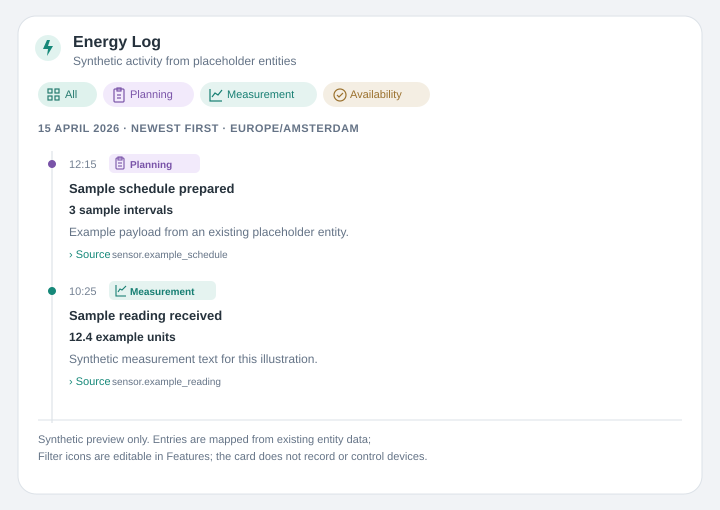

# Energy Log

Choose **Mushroom Addition: Energy Log** in the Home Assistant card picker, or
use `custom:mushroom-addition-energy-log`. The card displays timestamped data
that already exists in configured Home Assistant entities. It does not record
history, create sensors, poll services, control devices, or call external
services.

## Visual editor

All card settings are editable through the shared Mushroom editor's Context,
Content, Layout, Interactions and Features sections. Sources and categories use
Home Assistant's structured object selectors with native add/edit/delete dialogs
and ordering, verified against HA 2026.11 / frontend 20261028.4, as with Energy Plan
and Energy Insights. There is no separate Energy Log editor element.

- Shared Mushroom name, primary/secondary information, icon, layout and header
  actions, plus entry limit, sort order, time zone, clock format,
  footer, empty-state text, and source disclosures.
- Any number of entity sources, including each source's payload path and field
  mappings.
- Categories, including the IDs referenced by source entries, labels, colors,
  and icons. Each category is automatically available as a filter chip.

The editor validates source IDs and category IDs and reports incomplete or
invalid configuration rather than emitting it. Entries referencing a category
not in the configured list are reported as data errors.
Existing `title` and `subtitle` values remain supported as fallbacks for `name`
and `secondary`; the editor exposes the shared presentation fields instead.
Built-in labels use the 33 repository language catalogs; user-provided entry text
and category labels stay unchanged. Named colors resolve through the HA theme.

### Changing filter icons in the UI

Open the card editor and expand **Features**:

- **All: Icon** selects the icon for the built-in All filter.
- **Categories → Edit → select a category → Icon** changes that category's
  icon, for example Planning, Measurement, Availability or a category you added.
  The selected icon appears both in its filter chip and beside matching entries.

These are Home Assistant icon pickers; no YAML is required. Clear an icon to
show only the label. Existing configurations without `allIcon` retain the
text-only All filter. The card's Content icon is independent of filter icons.



## Source format

Each source points to an entity attribute containing a list of objects, or to
an entity state containing a JSON-encoded list. For state sources, set
`adapter: state`; `path` may select a nested list in the decoded JSON. Set
`adapter: attribute` to select an attribute path. Attribute sources require a
non-empty path to the list. Field mappings use dot-separated paths.

The timestamp field accepts an ISO date/time string or a Unix timestamp in
seconds or milliseconds. The category field must match a configured category
ID. The other fields are text. Missing entity IDs, `unknown` or `unavailable`
states, invalid payloads, malformed rows, invalid timestamps, and unknown
category references are shown as source errors. A valid list with no entries
is a valid empty log and displays the configured empty-state message.

When multiple sources are configured, valid entries still display if another
source is unavailable or invalid; the card reports that source error separately.
Changing Home Assistant states refreshes the rendered log. The configured
limit is applied after sorting. Filter chips do not alter or write source data.

## Example

This example uses only synthetic IDs, timestamps, and text. Replace the
placeholder entity ID with an entity in your own installation.

```yaml
type: custom:mushroom-addition-energy-log
title: Energy Log
subtitle: Example activity stream
icon: mdi:timeline-text-outline
allIcon: mdi:view-grid-outline
limit: 30
sortOrder: newest
timeZone: Europe/Amsterdam
clockFormat: "24"
showSource: true
emptyState: No example entries are available.
footer: This is an example view of existing entity data.
sources:
  - id: sample_stream
    entity: sensor.example_activity_log
    adapter: attribute
    path: entries
    timestampField: timestamp
    categoryField: category
    titleField: headline
    detailField: value_summary
    descriptionField: note
    sourceField: origin
categories:
  - id: planning
    label: Planning
    color: "#7e57c2"
    icon: mdi:clipboard-text-outline
  - id: measurement
    label: Measurement
    color: "#00897b"
    icon: mdi:chart-line
```

For this example, the configured entity could expose the following synthetic
attribute:

```yaml
entries:
  - timestamp: "2026-04-15T09:10:00+02:00"
    category: planning
    headline: Sample schedule prepared
    value_summary: 3 sample intervals
    note: Example payload stored in an existing entity attribute.
    origin: sensor.example_schedule
  - timestamp: "2026-04-15T10:25:00+02:00"
    category: measurement
    headline: Sample reading received
    value_summary: 12.4 example units
    note: Synthetic measurement text for documentation only.
    origin: sensor.example_reading
```

`timeZone` accepts an IANA time-zone name. Leave it empty to use Home
Assistant's configured time zone, falling back to the browser's zone. Date
headings and times use this zone. Native buttons and disclosure controls are
keyboard-operable, with visible focus styles and theme-aware colors.
