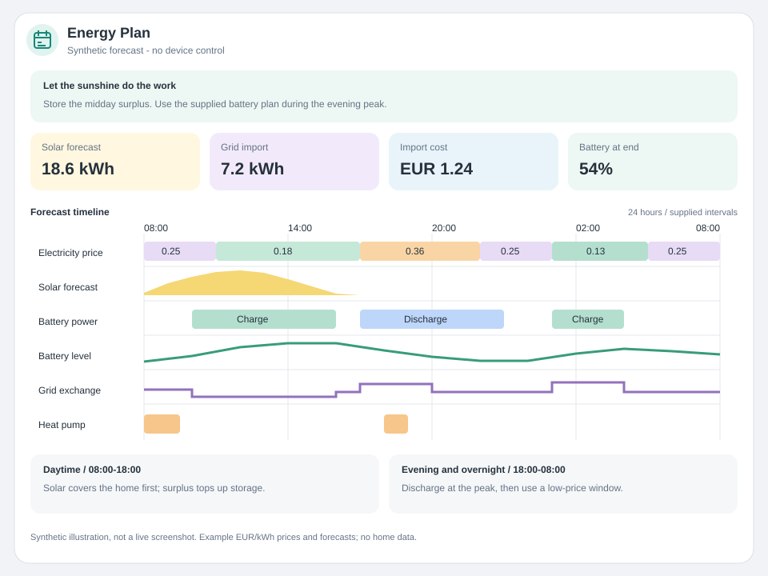

# Energy Plan

Choose **Mushroom Addition: Energy Plan** in the Home Assistant card picker.
The card and its editor are included in the existing bundle. No separate resource,
Mushroom dependency, custom backend, or YAML-only configuration is required.

This card displays supplied plans, not an optimizer or device controller.
It never estimates missing prices, simulates a battery, or runs a schedule.
Synthetic examples are isolated in `demo/energy-plan.html` and tests.



The illustration uses invented forecasts and prices; it contains no home data.

## Visual editor

The only editor adapter is the existing `mushroom-addition-editor`.
There is no Energy Plan editor custom element, custom row-management UI, separate
panel, or unstructured object/YAML selector. Native Home Assistant object selectors
with explicit fields provide add/edit/delete dialogs and drag ordering, including
metrics nested inside periods. **Features → Energy Plan → Edit** opens the
standard Home Assistant form. All object selectors define their field schemas.

Native selector behavior was checked against the released Home Assistant
2026.11 frontend (20261028.4). This is the supported editor baseline, not a claim
that these features first appeared in that release:
[native object selector](https://github.com/home-assistant/frontend/blob/20261028.4/src/components/ha-selector/ha-selector-object.ts).
Browser showcase selector shims and unit tests are not an end-to-end live HA test.

The shared editor retains its five sections:

| Section | Editable settings |
| --- | --- |
| Context | Default source entity, inherited by rows without their own entity |
| Content | Mushroom name, icon, primary and secondary information, custom secondary text |
| Layout | Visible hours, horizontal/vertical heading, multiline secondary text, fill container, card shadow |
| Interactions | Header tap, hold and double-tap actions |
| Features | Timeline source/start, section visibility, overview text, timeline title, sizing, rows, summaries and periods |

Every specialist setting listed below has a visual control. Rows, summary metrics
and periods can be added, removed and reordered. Each period can contain its own
addable/reorderable metrics. Validation errors stay visible and invalid edits are
not dispatched to Home Assistant; the draft stays available for correction.
Features are mounted only while that shared section is expanded.

## Sources and interval contract

Each timeline row can read its own sensor or inherit the Context entity. With
`adapter: attribute`, `path` selects an attribute array. With `adapter: state`,
the state must be JSON and `path` selects an array inside the parsed JSON; leave
the path empty for a JSON array at the root. Paths are dot-separated.

Every item needs:

- `startField`: ISO timestamp with timezone, Unix seconds, or Unix milliseconds.
- `endField`: timestamp after start; alternatively `durationField` in minutes.
- `valueField`: finite number, including zero or negative values where applicable.

Unconfigured, unavailable and malformed sources have explicit row messages.
Malformed entries, overlaps and battery percentages outside 0–100 reject the
whole source row rather than hiding corrupt entries. Empty arrays and intervals
outside the visible window display “No published intervals”. Gaps remain blank:
there is no interpolation, extrapolation or assumed zero. Adjacent equal prices
and adjacent matching schedule modes are grouped visually only; the inspector
still reads the original individual interval values.

## Feature options

`energy_plan` contains these settings; omitted settings receive the card defaults.

| Setting | Meaning |
| --- | --- |
| `start` | `now` (default) or `source` |
| `startEntity`, `startField` | Source timestamp from a sensor state or attribute; empty entity inherits Context |
| `showHeader`, `showOverview`, `showMetrics`, `showInspector`, `showPeriods`, `showLegend` | Independent section visibility, all enabled by default |
| `overview`, `description`, `timelineTitle` | Editable user text |
| `rowHeight` | 36–80 SVG units; default 48 |
| `minimumWidth` | 400–1600 px; default 720; narrow cards scroll horizontally |
| `axisStep` | 1–24 hours between timeline grid ticks; default 3. Dense axes automatically show fewer time labels to avoid overlap. |
| `maxAgeMinutes` | Maximum source age in minutes, 1–10080; default 60 |
| `rows`, `metrics`, `periods` | Repeatable lists described below |

`visibleHours` is a root-level Layout setting (1–168, default 24). Displayed times
use Home Assistant's configured timezone; tick labels include the weekday across
midnight. A minute timer refreshes the “now” window and is disposed on removal.
Only relevant entity, theme, timezone and locale changes rebuild the card.

## Rows

Seven rows are provided initially: prices, solar power, battery operation,
battery percentage, grid operation, house use and heat pump operation. The default
field names are `price`, `solar`, `battery`, `soc`, `grid`, `home` and `heat`,
respectively, in an attribute named `plan`. These are configurable conventions,
not automatic integration-specific entity mappings.

| Setting | Meaning |
| --- | --- |
| `id`, `enabled` | Unique row ID; independent visibility |
| `name`, `icon`, `color` | Label, MDI icon and theme-aware Mushroom/UI color |
| `kind` | `price`, `power`, `soc` or `schedule` |
| `entity`, `adapter`, `path` | Source sensor, attribute/JSON state and array path |
| `startField`, `endField`, `durationField`, `valueField`, `statusField` | Interval field mappings |
| `unit` | Source/display unit; no implicit numeric conversion |
| `scale` | Positive power magnitude at the full bar half-height, in the configured unit |
| `low`, `high`, `lowColor`, `highColor` | Price color thresholds in the configured price unit; low must not exceed high |
| `positiveLabel`, `negativeLabel`, `zeroLabel` | Schedule labels when no mapped textual status is supplied |

Prices support ISO currency units such as `EUR/kWh`, `USD/kWh`, and `ct/kWh`;
configure thresholds in the same unit. Values are not currency-converted.
Percentage rows require `%` and values within 0–100. Power bars use a shared
baseline: positive above and negative below. Percentage values are drawn as
separate dashed interval segments without bridging gaps. Schedules use the
mapped status if available, otherwise the configured sign-based labels.

The defaults assume positive battery power means charge, negative means discharge;
positive grid power means import, negative means export. Adapt the sign labels
to the source's convention. Power and schedule rows otherwise accept any display
unit. The card does not convert energy quantities into power.

## Summary metrics and periods

Summary metrics are deliberately source-backed rather than inferred from tracks.
Each has editable `name`, `entity`, optional attribute `field`, `unit`, `icon`
and `color`. Missing numeric data displays “Source missing”; zero is preserved.
Units are labels and must match the source. Up to 12 metrics are supported.
Rows and metrics check the entity's Home Assistant `last_updated` timestamp
against `maxAgeMinutes`. Stale or missing timestamps do not produce valid values.

Periods have editable `name`, `description`, `start`, `end` and their own metrics.
Start/end are elapsed-hour offsets from the timeline start, not wall-clock hours;
end must follow start (0–168). Periods are clipped to the visible horizon and
can be reordered. Period metric sources must already represent the intended
period: their values are not recomputed when the horizon changes.

Names, descriptions and entity-provided mode text remain user text, are escaped
by Lit, and are not translated as built-in UI labels. Built-in editor/presentation
labels use the repository's localization helpers and all accents use the shared
theme color resolver. Header interactions use the same Mushroom action handling
as existing cards; the timeline inspector itself never calls a device service.

## Minimal configuration

The following entity and field names are fictional placeholders:

```yaml
type: custom:mushroom-addition-energy-plan
name: Energy Plan
entity: sensor.example_energy_plan
visibleHours: 24
```

Its source sensor should expose a timestamped `plan` array. For example, one
entirely synthetic interval might be:

```yaml
plan:
  - start: "2030-01-15T08:00:00Z"
    end: "2030-01-15T08:15:00Z"
    price: 0.21
    solar: 2.8
    battery: 1.2
    soc: 64
    grid: -0.5
    home: 1.1
    heat: 0
```

These values are illustrative, not a recommendation. Configure actual source
fields through **Features** rather than copying fictional entity IDs.

## Local synthetic showcase

Run `npm ci` and `npm run demo`, then open `/demo/energy-plan.html`.
The showcase renders both real registered energy cards and shared editors against an
in-memory fictional Home Assistant object. Its small selector shims are for the
browser demo only; production uses Home Assistant's native `ha-form` selectors.
The showcase makes no external requests or device service calls. The card does
not persist demo data into Lovelace configuration. Its native-like demo selectors
are explicitly shims, not bundled Home Assistant components or proof of a real
Home Assistant editing session.
